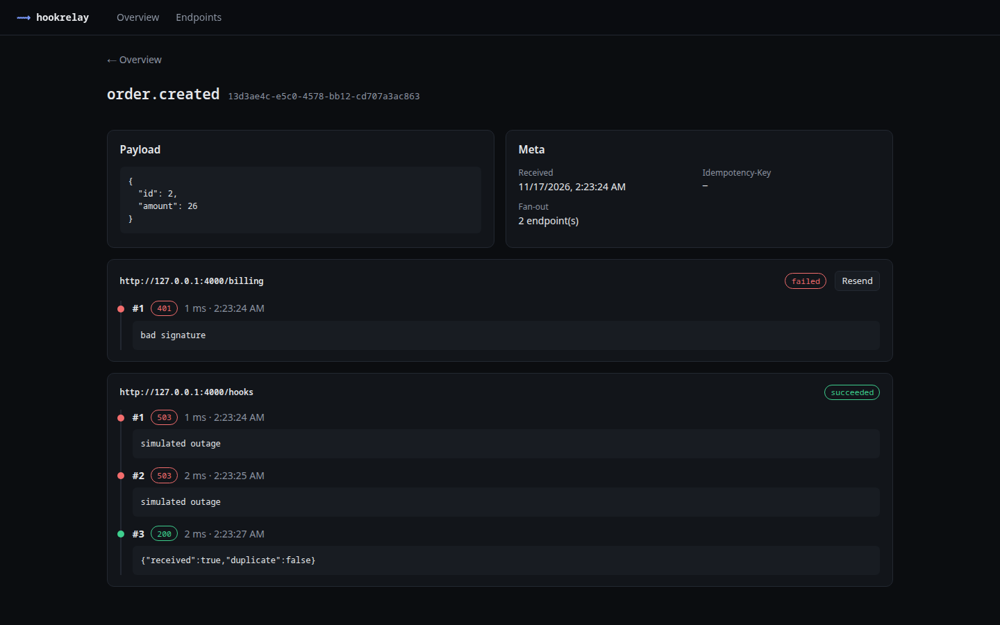
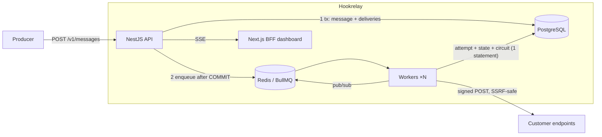

# Hookrelay

**Reliable webhook delivery as a service.** Your product sends one event; Hookrelay fans it out to every subscribed endpoint, signs each request, retries with backoff, blocks SSRF, and gives you a dashboard to inspect and replay every attempt.

`fetch(url, { body })` works fine until production: receivers go down for hours, time out, return 500s, or point at `169.254.169.254`. Hookrelay is the infrastructure layer that handles all of that (in the spirit of Svix or Hookdeck), built as a production-shaped reference system: hexagonal core, tests at three levels, observability, CI/CD, and AWS infrastructure as code.



| | |
|---|---|
| **Stack** | Node.js 24 · TypeScript · NestJS 12 · BullMQ 6 · PostgreSQL 17 · Redis 8 · Next.js 16 / React 19 · zod 4 |
| **Quality** | Vitest (unit + black-box integration) · k6 · ESLint · SonarQube · CodeQL · Trivy · gitleaks |
| **Ops** | OpenTelemetry · Prometheus · Grafana · Jaeger · Docker · GitHub Actions (OIDC) · Terraform · AWS ECS Fargate, RDS, ElastiCache |

## What it guarantees

- **No lost events.** The message and its deliveries commit in one Postgres transaction. If the enqueue fails afterwards, a sweeper re-enqueues anything `pending` with no job. Deterministic job IDs make that safe on any number of replicas.
- **At-least-once delivery** with a stable `webhook-id` so receivers can dedupe.
- **Idempotent ingestion**: the same `Idempotency-Key` returns the original message, even under concurrent requests.
- **Retries with jitter** (Standard Webhooks schedule: 5 s → 10 h), a **circuit breaker** that disables endpoints after consecutive failures or `410 Gone`, and **manual resend**.
- **Security by default**: Standard Webhooks HMAC signatures (checked against the official test vector), an SSRF guard enforced at *connect time* after DNS resolution (so DNS rebinding can't get around it), hashed API keys, per-tenant rate limits, and OWASP API Top 10 mapping.

## Measured

k6, 2 workers × 50 concurrency delivering at the same time, everything on one laptop (i7-13650HX):

| Ingestion rate | p50 | p95 | Errors |
|---|---|---|---|
| 200 req/s (2 min) | 2.4 ms | **3.9 ms** | 0 % |
| 400 req/s | 1.7 ms | **3.1 ms** | 0 % |
| 800 req/s (saturates at ~740) | 1.9 ms | 635 ms | 0 % |

The SLO is p95 < 300 ms for ingestion. One API instance holds ~400 req/s with large headroom. See [SCALABILITY](docs/SCALABILITY.md) for the bottleneck analysis and what changes at 10×.

## Architecture in one picture



The delivery core is hexagonal: `DeliverAttempt` (the use case) depends only on ports, and Postgres, undici, BullMQ and Redis are adapters. Details in [ARCHITECTURE](docs/ARCHITECTURE.md).

## Run it

```bash
cp .env.example .env
docker compose up -d                       # postgres, redis, api, 2 workers, web, demo receiver
curl -s -XPOST localhost:3000/v1/apps -H 'x-admin-token: change-me' \
  -H 'content-type: application/json' -d '{"name":"demo"}'      # -> { apiKey: "hr_..." }
HOOKRELAY_API_KEY=hr_... docker compose up -d web                # dashboard on :3001

# API reference (OpenAPI 3.1 generated from the zod contracts): http://localhost:3000/docs
# Observability: OTEL_SDK_DISABLED=false docker compose --profile observability up -d
#   Grafana :3002 · Prometheus :9090 · Jaeger :16686
```

## Tests

```bash
pnpm --filter api test        # 36 unit tests: domain, use case with fakes, SSRF guard (core coverage gate 90%)
pnpm --filter api test:int    # 8 black-box tests: real API + worker processes, Postgres, Redis, receiver
k6 run -e API=... -e KEY=... ops/load/ingest.js
```

## Documentation

| Doc | What's inside |
|---|---|
| [ARCHITECTURE](docs/ARCHITECTURE.md) | Context, containers, hexagonal core, sequences, data model |
| [ADRs](docs/adr) | Why Postgres is the source of truth, separate workers, connect-time SSRF, ECS over Lambda/EKS… |
| [IMPLEMENTATION_PLAN](docs/IMPLEMENTATION_PLAN.md) | Phases, what's done, what's next |
| [TEST_PLAN](docs/TEST_PLAN.md) | Test pyramid, cases, coverage policy, load testing |
| [DEPLOYMENT](docs/DEPLOYMENT.md) | AWS + Terraform + CI/CD, first deploy, rollbacks, cost estimate |
| [OBSERVABILITY](docs/OBSERVABILITY.md) | Logs, metrics, traces, SLOs, alerts, dashboards |
| [SECURITY](docs/SECURITY.md) | Threat model, OWASP API Top 10 mapping, accepted risks |
| [SCALABILITY](docs/SCALABILITY.md) | Load results, bottlenecks, scaling plan |
| [RUNBOOK](docs/RUNBOOK.md) | What to do when each alert fires |
| [ROADMAP](docs/ROADMAP.md) | Prioritized backlog of pending work |
| [CONTEXT](docs/CONTEXT.md) | Project memory: decisions, gotchas, how to resume work |
| [AGENTS.md](AGENTS.md) | Conventions for AI coding agents (spec-driven workflow) |

## Repository layout

```
apps/api/src
  delivery/domain           pure rules: retry policy, signatures
  delivery/application      DeliverAttempt use case + ports
  delivery/infrastructure   Postgres store, undici sender + SSRF guard, BullMQ, sweeper
  messages|endpoints|deliveries   HTTP controllers (thin, SQL-first)
  contracts.ts              zod schemas -> validation + OpenAPI
apps/web                    Next.js 16 dashboard (BFF: API key never reaches the browser)
examples/receiver           reference consumer that verifies signatures
infra/terraform             AWS: VPC, ECS Fargate, ALB, RDS, ElastiCache, Secrets Manager, alarms, OIDC roles
ops/observability           Prometheus rules, Grafana dashboard, Jaeger
ops/load                    k6 scenarios
.github/workflows           CI, CodeQL, deploy
docs/                       everything above
```

## License

MIT. Built by [David Manjarres](https://drtx2.github.io/portfolio/).
