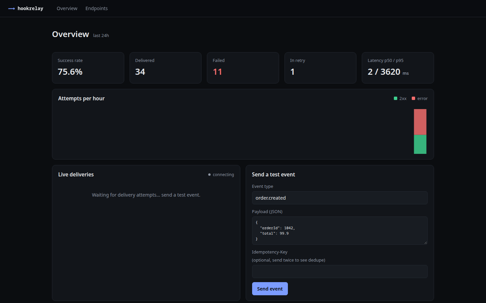
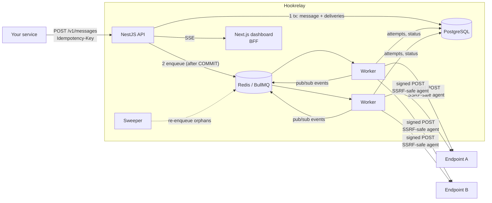

# Hookrelay

**Reliable webhook delivery as a service.** Your app sends one event; Hookrelay fans it out to every subscribed endpoint, signs each request, retries with backoff, protects your network from SSRF, and gives you a dashboard to inspect and replay every attempt.

Sending webhooks looks like `fetch(url, { body })` until production: receivers go down, time out, return 500s for hours, or point at `169.254.169.254`. Hookrelay is the infrastructure layer that makes that boring (in the spirit of Svix or Hookdeck).



## Architecture



| Process | Responsibility |
|---|---|
| `api` (NestJS) | Auth, validation, idempotent ingestion, fan-out, query endpoints, SSE |
| `worker` (NestJS app context, N replicas) | HTTP delivery, retries, circuit breaker, orphan sweeper |
| `web` (Next.js 16) | Dashboard. A BFF: the API key stays on the server, the browser only sees Next routes |

The API and workers are separate processes on purpose: a receiver that hangs for 15 s must never slow down ingestion.

## Delivery guarantees

- **At-least-once.** Every attempt is persisted before the next one is scheduled. Receivers dedupe on `webhook-id`, which stays the same across retries.
- **No lost events when Redis or a process dies.** The message and its deliveries are committed in one Postgres transaction. Enqueueing happens after COMMIT; if it fails, the **sweeper** finds `pending` rows with no job and re-enqueues them. Job IDs are deterministic (`delivery_attempt`), so the sweeper and workers can race safely on any number of replicas.
- **Idempotent ingestion.** The same `Idempotency-Key` returns the original message (`200`) and creates no new deliveries, even under concurrent requests (unique index + `ON CONFLICT`).
- **Retries with jitter.** The default schedule follows the Standard Webhooks recommendation (5 s, 5 m, 30 m, 2 h, 5 h, 10 h, 10 h) with ±20 % jitter so a recovering endpoint is not hit by a thundering herd. Configurable via `RETRY_SCHEDULE`.
- **Circuit breaker.** After `ENDPOINT_DISABLE_AFTER` consecutive failed attempts, or an immediate `410 Gone`, the endpoint is disabled and stops receiving new deliveries until someone re-enables it.
- **Postgres is the source of truth.** BullMQ only carries "attempt N of delivery X is due". Each retry is a new delayed job, so the attempt count never lives in two places.

## Security

- **Signatures**: [Standard Webhooks](https://www.standardwebhooks.com) HMAC-SHA256 (`webhook-id`, `webhook-timestamp`, `webhook-signature`), verified against the official spec test vector. A 5-minute timestamp tolerance blocks replays, and receivers accept multiple signatures for secret rotation.
- **SSRF protection**: customers choose the target URL, so every connection goes through an undici `Agent` whose DNS `lookup` rejects loopback, RFC1918, link-local (cloud metadata), CGNAT, multicast and IPv4-mapped IPv6 addresses. Checking inside the connect step, not before `fetch`, closes the DNS-rebinding window. Redirects are not followed.
- **API keys** are random 192-bit tokens stored only as SHA-256. Admin token comparison is constant-time.
- **Tenant isolation**: every query is scoped by the `app_id` resolved from the key.

## Run it

```bash
cp .env.example .env
docker compose up -d postgres redis api worker receiver

# create a tenant (returns the API key once)
curl -s -XPOST localhost:3000/v1/apps -H 'x-admin-token: change-me' \
  -H 'content-type: application/json' -d '{"name":"demo"}'

# start the dashboard with that key
HOOKRELAY_API_KEY=hr_... docker compose up -d web   # http://localhost:3001
```

The `receiver` service is a reference consumer that verifies signatures with plain `node:crypto` and fails 30 % of requests on purpose so you can watch retries happen. Register `http://receiver:4000/hooks` as an endpoint and set `WEBHOOK_SECRET` to its secret.

Local dev without Docker for the apps: `pnpm i`, then `pnpm dev:api`, `pnpm dev:worker`, `pnpm dev:web`.

## API

All routes take `Authorization: Bearer hr_...`.

| Method | Route | |
|---|---|---|
| `POST` | `/v1/messages` | `{ eventType, payload }`, optional `Idempotency-Key`. `202` new, `200` duplicate |
| `GET` | `/v1/messages?limit&before&eventType` | Cursor-paginated, with per-message delivery status |
| `GET` | `/v1/messages/:id` | Payload, deliveries and the full attempt timeline |
| `GET/POST` | `/v1/endpoints` | List with 24 h health / create (returns the signing secret) |
| `POST` | `/v1/endpoints/:id/enable` · `/disable` | Manual circuit control |
| `POST` | `/v1/deliveries/:id/retry` | Resend a failed delivery (one attempt) |
| `GET` | `/v1/stats` | Success rate, p50/p95 latency, hourly series |
| `GET` | `/v1/stream` | Server-Sent Events: live delivery attempts |

Payload envelope sent to receivers: `{ "type": "order.created", "timestamp": "...", "data": { ... } }`.

## Verifying a webhook (receiver side)

```js
import { createHmac, timingSafeEqual } from 'node:crypto';

function verify(secret, headers, rawBody) {
  const id = headers['webhook-id'], ts = headers['webhook-timestamp'];
  if (Math.abs(Date.now() / 1000 - Number(ts)) > 300) return false;
  const key = Buffer.from(secret.replace(/^whsec_/, ''), 'base64');
  const expected = 'v1,' + createHmac('sha256', key).update(`${id}.${ts}.${rawBody}`).digest('base64');
  return headers['webhook-signature'].split(' ')
    .some((s) => s.length === expected.length && timingSafeEqual(Buffer.from(s), Buffer.from(expected)));
}
```

## Tests

```bash
pnpm test   # signing (spec vector), backoff/jitter, retry decision table, SSRF ranges + URL rules
```

Ingestion, idempotency, retries, manual resend, circuit breaker, SSE and the Docker stack were verified end to end against real Postgres and Redis.

## Stack

NestJS 12 (ESM) · BullMQ 6 · PostgreSQL 17 (raw SQL, forward-only migrations behind an advisory lock) · Redis 8 · undici · zod · Next.js 16 (App Router, Server Actions, BFF) · Vitest · Docker Compose

## Trade-offs and next steps

- Endpoints match exact event types. Wildcards (`order.*`) are the obvious next feature.
- No per-endpoint rate limiting yet. A slow receiver can use up worker concurrency (bounded by the 15 s timeout).
- Attempts are kept forever. Production needs a retention job, or partitioning `attempts` by month.
- Single-key BFF dashboard. Multi-user login would sit in front of it.
