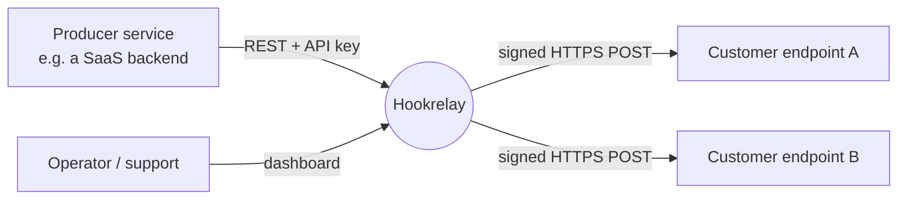
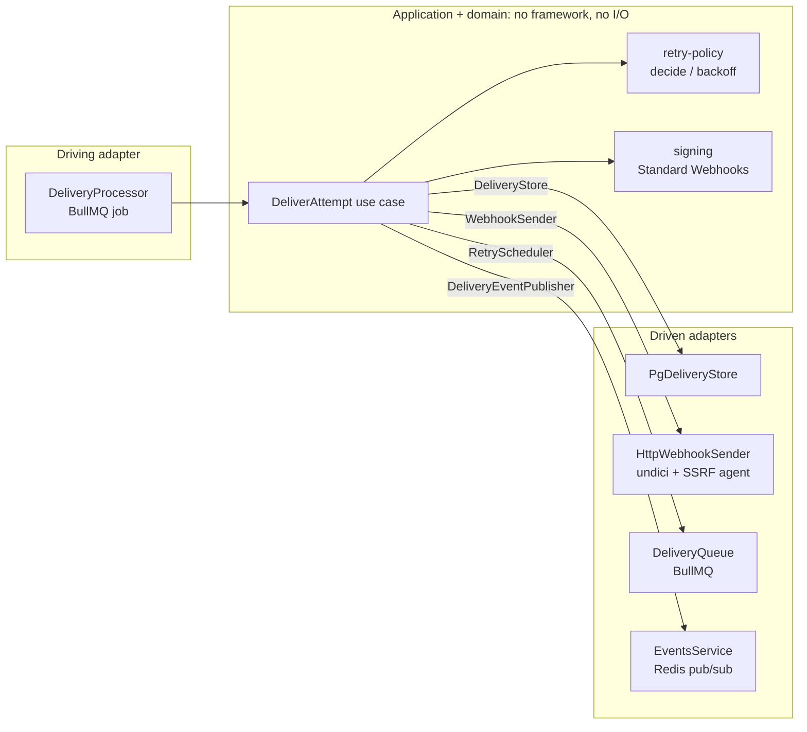
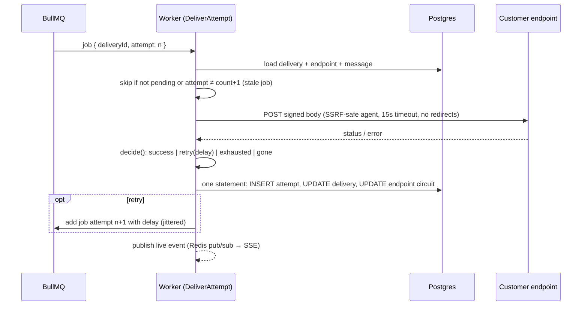
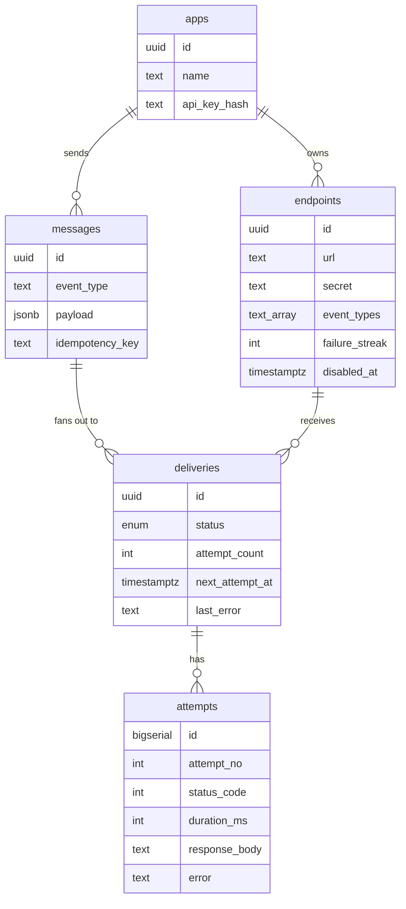

# Architecture

## 1. Context



A producer emits business events (`order.created`). Its customers registered URLs that should receive them. Hookrelay owns everything in between: fan-out, signing, retries, failure isolation, auditability and replay.

## 2. Containers

| Container | Tech | Responsibility | Scales on |
|---|---|---|---|
| `api` | NestJS 12 on Express 5 | Auth, validation, idempotent ingestion, fan-out, queries, SSE, OpenAPI | CPU / request rate |
| `worker` | NestJS application context + BullMQ | HTTP delivery, retry scheduling, circuit breaker, orphan sweeper | Queue depth (CPU today) |
| `web` | Next.js 16 (App Router, Server Actions) | Dashboard. A BFF: the API key lives on the server only | Rarely needed |
| PostgreSQL 17 | RDS | **Source of truth**: tenants, endpoints, messages, deliveries, attempts | Vertical, then partitioning |
| Redis 8 | ElastiCache | Job queue (BullMQ), pub/sub for live events, rate-limit counters | Vertical / cluster |

API and workers are separate processes on purpose ([ADR-0002](adr/0002-separate-worker-process.md)): a receiver that hangs for 15 s must never slow down ingestion.

## 3. The delivery core (hexagonal)



- `delivery/domain`: pure functions (retry decision table, jittered backoff, HMAC signing).
- `delivery/application`: `DeliverAttempt` plus the port interfaces. It doesn't import Nest, SQL or an HTTP client, so every branch is unit tested with in-memory fakes (`test/unit/deliver-attempt.test.ts`).
- `delivery/infrastructure`: adapters, wired in one place (`WorkerModule`, the composition root).

The CRUD-style controllers (`endpoints`, `messages`, `deliveries`) stay thin and SQL-first on purpose. Wrapping simple reads in repositories would add indirection without isolating any real business rule ([ADR-0004](adr/0004-pragmatic-hexagonal-core.md)).

## 4. Key flows

### Ingestion

```mermaid
sequenceDiagram
  participant P as Producer
  participant A as API
  participant DB as Postgres
  participant Q as Redis (BullMQ)
  P->>A: POST /v1/messages (Idempotency-Key)
  A->>A: ApiKeyGuard (sha256 lookup) → RateLimitGuard (Redis INCR)
  A->>DB: BEGIN; INSERT message ON CONFLICT DO NOTHING
  alt duplicate key
    A-->>P: 200 { id, duplicate: true }
  else new
    A->>DB: INSERT deliveries for matching, enabled endpoints; COMMIT
    A->>Q: addBulk(jobId = delivery_1)
    Note over A,Q: if this fails, rows stay 'pending'<br/>and the sweeper enqueues them
    A-->>P: 202 { id, fanout }
  end
```

### Delivery and retry



Every retry is a **new delayed job** with a deterministic ID, so the database holds the attempt count, not Redis ([ADR-0001](adr/0001-postgres-source-of-truth.md)).

### Recovery (sweeper)

Every 60 s each worker selects `pending` deliveries whose due time passed more than 2 minutes ago and re-enqueues them. Because job IDs are `deliveryId_attempt`, re-adding a job that's still queued does nothing. This covers crashes between COMMIT and enqueue, Redis outages and flushed queues.

## 5. Data model



- `UNIQUE (app_id, idempotency_key)` enforces idempotency. `UNIQUE (message_id, endpoint_id)` stops a delivery from being duplicated.
- The partial index `deliveries_pending_idx ... WHERE status = 'pending'` keeps the sweeper scan small no matter how much history piles up.
- Migrations are forward-only SQL files applied at boot under a Postgres advisory lock, so the API and workers can start at the same time safely.

## 6. Cross-cutting concerns

| Concern | Where |
|---|---|
| Validation | `contracts.ts` (zod) → `Zod` pipe; the same schemas generate `/openapi.json` |
| AuthN | `ApiKeyGuard` (tenant API key, SHA-256 at rest), `AdminGuard` (constant-time compare) |
| Rate limiting | `RateLimitGuard`: per-tenant fixed window in Redis |
| Logging | Nest `ConsoleLogger` in JSON mode, one line per request with `x-request-id` |
| Metrics | `prom-client`: API `/metrics`, worker `:9464/metrics` |
| Tracing | OpenTelemetry auto-instrumentation via `NODE_OPTIONS` (http, express, pg) → OTLP |
| Config | env vars only (12-factor). Secrets come from AWS Secrets Manager in production |

## 7. Deployment view (AWS)

See [DEPLOYMENT](DEPLOYMENT.md). In short: ALB (public subnets) → ECS Fargate services `api` / `worker` / `web` (private subnets) → RDS PostgreSQL + ElastiCache Redis (private, encrypted), with images in ECR, secrets in Secrets Manager, and CloudWatch alarms on SNS (KMS CMK). Everything is in `infra/terraform`.
