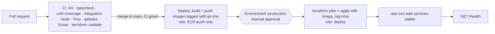

# Deployment (AWS · Terraform · GitHub Actions)

> Status: the Terraform passes `fmt` and `validate` and the workflows pass `actionlint`, but **neither has been applied to a real AWS account yet**. The steps below are the plan for the first deploy.

## Target topology

```mermaid
flowchart TB
  U[Internet] --> ALB[ALB · public subnets<br/>/v1/*, /docs, /health → api<br/>/* → web]
  subgraph VPC 10.40.0.0/16 · 2 AZs
    ALB --> API[ECS Fargate: api ×2..6]
    ALB --> WEB[ECS Fargate: web ×1]
    W[ECS Fargate: worker ×2..10]
    API & W --> RDS[(RDS PostgreSQL 17<br/>Multi-AZ, encrypted, PITR 7d)]
    API & W --> EC[(ElastiCache Redis 7<br/>TLS + AUTH, noeviction, failover)]
    W --> NAT[NAT gateway per AZ] --> CUST[Customer endpoints]
  end
  SM[Secrets Manager] -. injected at start .-> API & W & WEB
  ECR[ECR · immutable tags, scan on push] -. images .-> API & W & WEB
  CW[CloudWatch logs + alarms] --> SNS[SNS · KMS CMK] --> Email
```

| File | What it creates |
|---|---|
| `network.tf` | VPC (community module), public/private subnets, NAT, 3 security groups (alb → app → data) |
| `data.tf` | RDS PostgreSQL, ElastiCache Redis replication group (`noeviction`: an evicted job is a lost webhook) |
| `secrets.tf` | Generated passwords, `DATABASE_URL`/`REDIS_URL`/`ADMIN_TOKEN` secret, dashboard key secret |
| `ecr.tf` | `hookrelay-api` (used by api **and** worker) and `hookrelay-web` repos, lifecycle policy |
| `alb.tf` | ALB, target groups, HTTP→HTTPS redirect when a cert is set, path routing (`/metrics` deliberately not routed) |
| `ecs.tf` | Cluster, task definitions, services with the deployment circuit breaker (auto rollback), CPU autoscaling |
| `iam.tf` | Least-privilege task roles. GitHub OIDC provider and **two** roles: ECR push (main branch) and deploy (`production` environment only) |
| `alarms.tf` | ALB 5xx, p95 latency, worker CPU, RDS CPU/storage, Redis memory → SNS (encrypted with a CMK) |

## First deploy (one time)

1. **State bucket.** Create an S3 bucket with versioning, then `cp infra/terraform/backend.hcl.example infra/terraform/backend.hcl` and fill it in.
2. **Bootstrap apply from a laptop** (admin credentials, once):
   ```bash
   cd infra/terraform
   terraform init -backend-config=backend.hcl
   # The first apply needs an image tag that exists, so push images manually once:
   terraform apply -var-file=envs/production.tfvars -var image_tag=bootstrap \
     -target=aws_ecr_repository.app -target=aws_iam_role.github_ecr -target=aws_iam_role.github_deploy
   # docker build/push apps/api and apps/web with tag "bootstrap" to the ECR URLs from the output
   terraform apply -var-file=envs/production.tfvars -var image_tag=bootstrap
   ```
3. **GitHub settings.** Repo variables `AWS_REGION`, `AWS_ECR_ROLE_ARN`, `AWS_DEPLOY_ROLE_ARN` (from outputs). Create an Environment `production` with required reviewers.
4. **Create the dashboard tenant.** `POST /v1/apps` with the admin token (read it from Secrets Manager), write the key to the `web-api-key` secret, then `aws ecs update-service --force-new-deployment` for `web`.
5. **HTTPS.** Request an ACM certificate, set `certificate_arn` in `production.tfvars`, apply.

## Continuous delivery



- **No long-lived AWS keys**: GitHub OIDC tokens are exchanged for short-lived role credentials. Trust policies pin the repo **and** the branch/environment.
- **Immutable artifacts**: one image per commit, deployed by digest-equivalent tag. ECR tags can't be overwritten.
- **Migrations** run at container start under a Postgres advisory lock (forward-only, additive). For destructive changes use expand/contract across two releases.

## Rollback
- **Automatic**: if new tasks fail health checks, the ECS deployment circuit breaker rolls back to the previous task definition.
- **Manual**: re-run the Deploy workflow (`workflow_dispatch`) on the previous good commit, or `terraform apply -var image_tag=<previous sha>`.
- **Data**: RDS point-in-time restore (7 days). Redis holds no source-of-truth data; after a flush the sweeper rebuilds the queue.

## Environments
`envs/production.tfvars` is provided. For staging, copy it with smaller settings (`db_multi_az=false`, `single_nat_gateway` happens automatically for non-production, `worker_desired=1`) and a separate state key.

## Cost estimate (us-east-1, monthly, rough)
| Item | Production (as configured) | Minimal staging |
|---|---|---|
| NAT gateways | 2 × ~$33 | 1 × ~$33 |
| ALB | ~$20 | ~$20 |
| Fargate (2 api + 2 worker × 0.5 vCPU/1 GB, 1 web 0.25/0.5) | ~$80 | ~$30 |
| RDS db.t4g.micro Multi-AZ, 20 GB | ~$30 | ~$15 |
| ElastiCache 2 × cache.t4g.micro | ~$25 | ~$12 |
| CloudWatch, Secrets, ECR, KMS | ~$10 | ~$5 |
| **Total** | **≈ $230** | **≈ $115** |

Biggest levers: NAT (VPC endpoints for ECR/Logs/Secrets cut NAT traffic), Fargate Spot for workers (they're interruptible by design), and Savings Plans.
