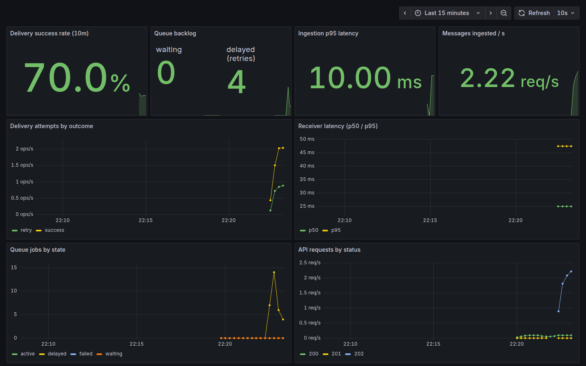
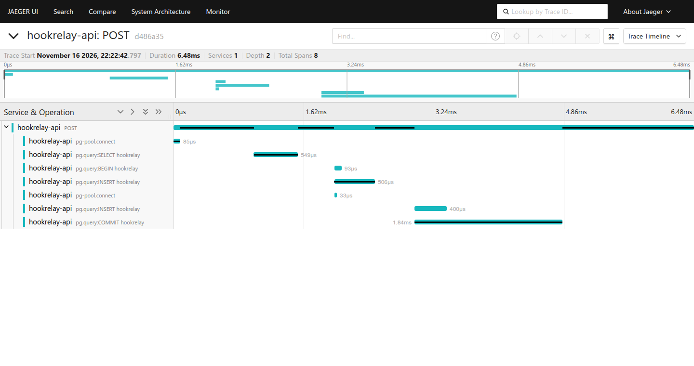

# Observability

Three signals, one correlation key (`x-request-id`), verified end to end with real traffic in the local stack.

```bash
OTEL_SDK_DISABLED=false docker compose --profile observability up -d
# Grafana http://localhost:3002 (anonymous, dashboard "Hookrelay") · Prometheus :9090 · Jaeger :16686
```

## SLOs
| SLI | Objective | Measured by | Alert |
|---|---|---|---|
| Ingestion availability (`POST /v1/messages` non-5xx) | 99.9% / 30 days | `hookrelay_http_request_duration_seconds_count` | `ApiErrorRateHigh` (> 2% for 5 m) |
| Ingestion latency | p95 < 300 ms | same histogram | `IngestLatencyHigh` |
| Delivery freshness | 99% of first attempts start < 60 s after ingestion | queue `waiting` depth (proxy) | `QueueBacklogGrowing` (> 5k for 5 m) |
| Delivery health (platform side) | failing attempts < 25% across all endpoints | `hookrelay_delivery_attempts_total` | `DeliveryFailureRateHigh` |

Receiver failures are *customer* errors, not platform errors. The failure-rate alert looks at the aggregate, because one broken endpoint shouldn't page anyone (its circuit breaker handles it).

## Logs
- Nest `ConsoleLogger` in **JSON** when `NODE_ENV=production` or `LOG_FORMAT=json`. Shipped to CloudWatch by the `awslogs` driver (30-day retention).
- One line per request: `requestId`, method, path, status, ms. Bodies, API keys and secrets are **never** logged (`no-console` lint rule keeps everything going through the logger).
- `x-request-id` is accepted from callers (≤100 chars) or generated, and echoed back in the response.
- Debug delivery lines (`delivery #n -> status`) are behind `LOG_DEBUG=true`.

CloudWatch Logs Insights example:
```
fields @timestamp, message.requestId, message.status, message.ms
| filter message.path = "/v1/messages" and message.status >= 500
| sort @timestamp desc
```

## Metrics (Prometheus, `prom-client`)
| Metric | Type | Labels | Meaning |
|---|---|---|---|
| `hookrelay_messages_ingested_total` | counter | `duplicate` | accepted messages |
| `hookrelay_delivery_attempts_total` | counter | `outcome` = success/retry/exhausted/gone/skipped/endpoint-disabled | worker results |
| `hookrelay_delivery_attempt_duration_seconds` | histogram | `outcome` | time spent waiting for receivers |
| `hookrelay_http_request_duration_seconds` | histogram | `method`, `route` (templated), `status` | API latency/traffic |
| `hookrelay_queue_jobs` | gauge | `state` = waiting/delayed/active/failed | queue depth, sampled on scrape |
| `hookrelay_process_*`, `hookrelay_nodejs_*` | default | | CPU, memory, event loop lag, GC |

API: `GET /metrics` (not routed by the ALB). Worker: `:9464/metrics` (`METRICS_PORT`). Locally, Prometheus discovers every worker replica through Docker DNS.



## Traces (OpenTelemetry)
Zero-code auto-instrumentation, enabled by environment:
```
NODE_OPTIONS=--require @opentelemetry/auto-instrumentations-node/register
OTEL_SERVICE_NAME=hookrelay-api | hookrelay-worker
OTEL_EXPORTER_OTLP_ENDPOINT=http://collector:4318
OTEL_NODE_ENABLED_INSTRUMENTATIONS=http,express,pg,ioredis,undici
OTEL_SDK_DISABLED=false
```
An ingestion trace shows the API key lookup, `BEGIN`, message insert, deliveries insert and `COMMIT` (≈6 ms total):



In AWS, point `OTEL_EXPORTER_OTLP_ENDPOINT` at an ADOT collector sidecar → X-Ray, or at any OTLP backend (Grafana Cloud, Honeycomb).

### Known gaps
| Gap | Impact | Fix |
|---|---|---|
| ioredis v6 isn't covered by the current instrumentation | BullMQ enqueue / Redis calls missing from traces | Upgrade when instrumentation supports v6, or add manual spans around `schedule()` |
| Express 5 routes appear as `POST`, not `POST /v1/messages` | Harder to group traces | Set span names from `req.route` in the request logger, or use `@opentelemetry/instrumentation-nestjs-core` |
| No trace context propagation API → worker | Ingestion and its deliveries are separate traces | Put `traceparent` into job data and start the worker span as a child/link |
| Prometheus isn't scraped in AWS | Only CloudWatch built-in metrics alert in production | Amazon Managed Prometheus + ADOT, or CloudWatch EMF for the custom metrics |

## Alerts
Prometheus rules: `ops/observability/alerts.yml`. AWS equivalents (CloudWatch → SNS): `infra/terraform/alarms.tf`. Every alert links to a [RUNBOOK](RUNBOOK.md) section.
